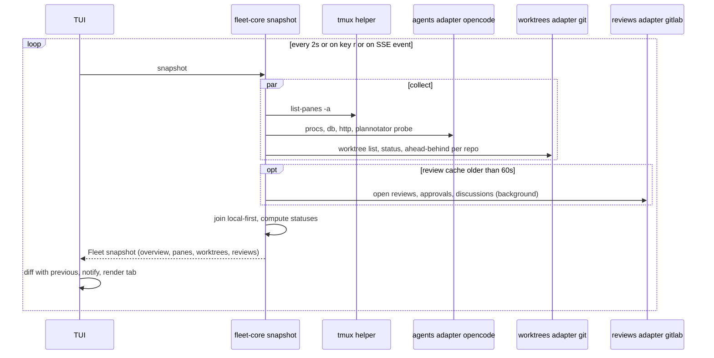
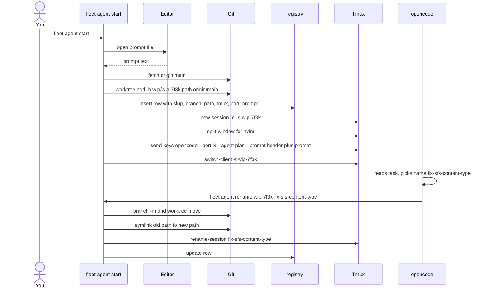
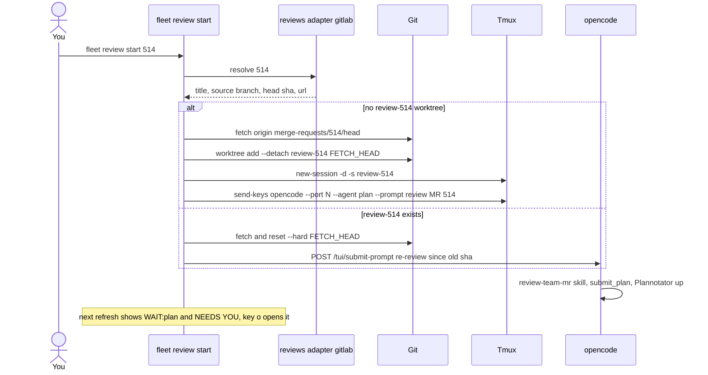
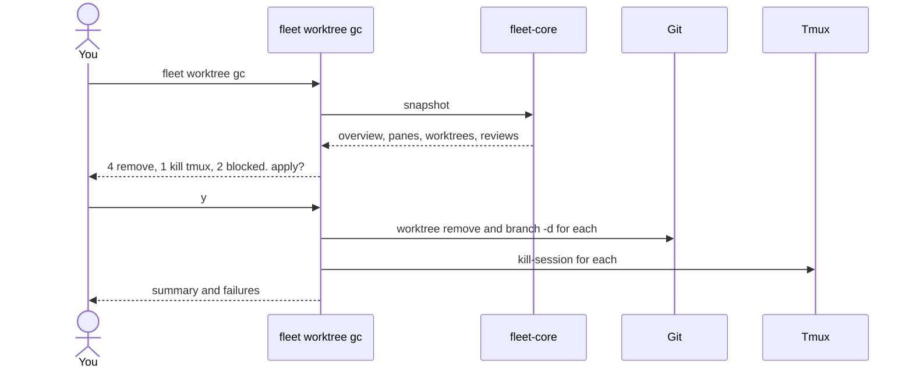

# `fleet` — a Rust TUI that tracks and launches your local coding agents (design, v1 = view + start + review + gc)

**Settled, not repeated:** name = `fleet` · Rust, new repo · **ratatui + crossterm**, clap · no daemon · library boundary (`fleet-core` + `fleet` binary; `fleet serve` later) · view-only, no auto-reviewer · **macOS banner + tmux status counter** · one slug for branch + folder + tmux session, central worktrees dir with override · optional name = temp slug + agent renames itself · **collectors = three adapter families: agents (opencode), reviews (GitLab), worktrees (git)**; tmux is a small shared helper · **tabs: Overview (joined, local-first) · Tmux · Worktrees · Reviews (with a source picker)** · **several repos** in config · which-key prefix menus generated from `[keys]` · opencode todos unused · Linear later.

> Correction: the previous plan file was corrupted (it contained text from an unrelated review). This is the full plan, resubmitted from line 1. Only Q1 (nouns) is still open.

## Background (terms used below)

- **Agent** — one running `opencode` process on one task (20 now). Mode `plan` (read-only, writes a plan) or `build` (edits code), stored per session.
- **opencode session** — the conversation record (`ses_…`, title, directory, mode) in `~/.local/share/opencode/opencode.db` (SQLite, read-only for us).
- **Worktree** — a checkout of a repo in its own folder on its own branch (the main clone counts as one). **Synced** = local and remote branch at the same commit; **ahead/behind** = commits only local / only remote; **dirty** = uncommitted edits.
- **tmux session/window/pane** — each agent is one pane beside a `zsh`/`nvim` pane. **Attached** = a terminal currently shows that session.
- **Plannotator** — the browser review UI; on `submit_plan` a web server starts **inside the opencode process** on a random `127.0.0.1` port. Closing the tab loses the URL, not the server.
- **Review** (fleet's word) — a GitLab MR today, a GitHub PR tomorrow. **Thread** = one review-comment conversation, **resolved** or **unresolved**. **CI** = the pipeline run on the head commit.
- **Adapter** — one implementation of a collector family (e.g. the GitLab adapter of the reviews family).

## What I found on your machine (evidence the design rests on)

| Fact | Evidence | Consequence |
|---|---|---|
| 20 tmux sessions, each `zsh\|nvim` + `opencode` pane; pane title `OC \| <task>` | `tmux list-panes -a` | discovery keys on the `opencode` pane; no tmux config change |
| tmux name ≠ worktree folder ≠ branch (`monid-lev8` → `monid-add-lev8-provider` → detached HEAD) | `git worktree list` | the joiner maps pid → pane → cwd → worktree → branch |
| **7 Plannotator servers alive; `plannotator sessions` says none** | `lsof` + `GET /api/plan` returned each plan title [LOCAL] | lost tabs recovered by **port probing** |
| The opencode TUI binds **no TCP API by default**; only Plannotator listens | all 8 opencode sockets served Plannotator | existing agents: state from the DB only |
| **`opencode --port N` exposes the full HTTP API**: `/event` (SSE incl. `permission.updated`), `/session/status`, `/session/{id}/permissions/{id}`, `/tui/submit-prompt` | SDK route list; `--port` on the TUI command | fleet-started agents report permission prompts, exact busy/idle, and accept messages. **Verify in M0** |
| DB tells what an agent is blocked on: last assistant message `time.completed` null + a tool part `state.status='running'` naming the tool (`submit_plan`×5, `question`, `bash`×4) | `sqlite3` on `message`/`part` | `WAIT:plan` / `WAIT:question` / `WORKING` / `IDLE` for every agent, old or new |
| Permission prompts are not in the DB | `permission` table = saved rules | legacy agents can't show `WAIT:perm`; fleet-started ones can |
| `opencode --prompt <text> --agent <plan\|build>` seeds a session | `opencode --help` | `fleet agent start` hands the first prompt over |
| `glab api …/merge_requests?state=opened` → `iid, title, author, source_branch, draft, detailed_merge_status, blocking_discussions_resolved, user_notes_count, head_pipeline.status, web_url`; `/approvals` → `approved_by[]`; `/discussions` → per-thread `resolved` | ran on `fix/sfs-content-type` → !530, 13 notes | per refresh: one list call + per open review one `/approvals` and one `/discussions` (cached 60 s, background) |
| opencode keeps its **start directory as an absolute string** (DB `session.directory`; file tools resolve against it) | schema + Read/Edit behaviour | a renamed worktree needs a **symlink at the old path** while the agent lives (Change 3) |

---

# SECTION 1 — Answers, clarifications, decisions

## Q1. Command tree (nouns `agent` / `review` / `worktree`)

You asked for forge-neutral wording. `review` is my pick for MR/PR, and `worktree` is the full word (your "watch" read as dictation for it). Confirm below.

```
fleet                                 open the TUI
fleet agent start [NAME] [-m TEXT|-f FILE] [--repo R]   worktree + branch + tmux + opencode
fleet agent list [--json]             agents (all adapters)
fleet agent attach NAME               tmux switch/attach
fleet agent send NAME TEXT            message the agent (HTTP or tmux send-keys)
fleet agent rename OLD NEW            branch + folder (+symlink) + tmux session + registry
fleet agent stop NAME                 kill the opencode pane; keep the worktree
fleet review list [--source gitlab:monid-services] [--json]   open reviews across configured sources
fleet review start ID|URL             detached worktree + tmux + review agent; re-review if it exists
fleet worktree list [--json]          worktrees across configured repos
fleet worktree gc [--yes]             cleanup with dry run
fleet tmux list [--json]              sessions / windows / panes with what runs in them
fleet status [--short|--json]         one-shot snapshot (status bar / scripts)
```
`fleet start` = `agent start`, `fleet review 514` = `review start 514`.

:::question
Q1 — nouns
- [ ] `review` + `worktree` (Recommended)
- [ ] `request` + `worktree`
- [ ] I literally meant `watch` — explain what it should do
:::

## Q2. Known gaps (v2)

1. **Permission prompts on legacy agents** (no `--port`): show as `WORKING`. Everything started through fleet reports them. Legacy coverage would need a ~50-line TS opencode plugin; not planned.
2. **Other agent adapters, GitHub adapter, Linear, auto-reviewer, `fleet serve`** — all behind the adapter traits and the serde contract; none in v1.

---

# SECTION 2 — Changes

## Change 1 🔴 `fleet-core`: three collector families, one joiner

**Problem.** Nothing joins pane ↔ opencode session ↔ worktree ↔ Plannotator URL ↔ review; you do it in your head 20 times, and can't see which worktrees are unsynced or which reviews are approved/failed without opening each one.

**Collector families and adapters** (every adapter returns plain serde rows; the joiner never knows which adapter produced them):

```
family      trait                 v1 adapter   what it reads
----------  --------------------  -----------  --------------------------------------------------------------
agents      AgentAdapter          opencode     procs (sysinfo: opencode pids, ppid, cwd)
                                               db (rusqlite ro: session id/title/directory/mode, last msg done?, running tool)
                                               http (registry rows with a port: /session/status, SSE /event)
                                               plannotator probe (listening ports -> GET /api/plan -> url, plan title)
reviews     ReviewAdapter         gitlab       glab api: open MRs, /approvals, /discussions (resolved per thread)
                                               one adapter instance per configured source, e.g. gitlab:monid-ai/monid-services
worktrees   (single)              git          git worktree list --porcelain per repo; status --porcelain;
                                               rev-parse @{u}; rev-list --left-right --count @{u}...HEAD
helper      tmux (not an adapter) tmux         list-panes -a: pane_pid, session, window, pane, cwd, command, attached
```

**Rows:** `AgentRow { adapter, pid, cwd, session_id, title, mode, activity, plan_url, port }` · `ReviewRow { source, id, title, author, source_branch, target_branch, draft, ci, approvals[], threads{total,resolved,unresolved}, status, head_sha, url, updated_at }` · `WorktreeRow { repo, path, name, branch, upstream, ahead, behind, dirty, detached }` · `PaneRow { session, window, pane, pid, cwd, command, attached }`.

**Join** (local-first: start from what exists on this machine):
1. For each **worktree** (every configured repo): agents whose canonicalised cwd is under it; panes whose cwd is under it; reviews whose `source_branch == branch` (any source). → one **Overview** row per worktree; a worktree can carry 0..n agents.
2. For each **agent**: its pane = the pane whose `pane_pid` is an ancestor of the agent pid; its worktree from step 1; `WAIT:plan` from the probe; fleet-started agents matched by registry port.
3. For each **review**: the set of worktrees on its branch (0..n) and the agents inside them (0..n) — one-to-many, shown as counts with the list in the detail panel.
4. Agents in a directory that is no worktree of a configured repo → an "outside repos" group at the bottom of Overview (never hidden).

**Per-family status (shown in that family's column everywhere):**

| Family | Values |
|---|---|
| AGENT | `plan`/`build` + `⏳ WAIT:plan` · `❓ WAIT:question` · `🔒 WAIT:perm` (fleet-started only) · `● WORKING` · `○ IDLE` · `— NONE` |
| TMUX | `session:w.p` + `●` attached · `○` detached · `—` none |
| WORKTREE | `=` synced · `↑n` ahead · `↓n` behind · `↕` diverged · `*` dirty · `⊘` no upstream · `(detached)` · `✗` folder missing |
| REVIEW | STATUS `draft` · `open` · `approved` · `mergeable` · `conflicts` · `ci failed` · `merged` · `closed`; CI `✓ ✗ ⟳ –`; approvals `👍n`; comments `💬 total · ✔resolved · ✘unresolved` |
| OVERALL (Overview only) | first match: `NEEDS YOU` (any WAIT) → `FAILED` (CI ✗ or conflicts) → `READY` (all agents IDLE/none + open review + synced + CI ✓) → `MERGED` → `WORKING` → `IDLE` → `DEAD` (no agent, nothing open) |

**Worked example** (real rows today):

| input | today | after |
|---|---|---|
| pid 68161 listens :59503, pane `monid-services:3.0`, worktree = main clone | which tab was that? | Overview row `monid-services` (repo monid-services, `main =`) → agents: `plan ⏳ WAIT:plan` → **NEEDS YOU**; `o` opens `http://127.0.0.1:59503` |
| `fix/sfs-content-type`, !530, 13 notes | open the MR to find out | Overview: `fix/sfs-content-type ↑2` · review `!530 open – 👍0 💬13 ✔9 ✘4` → `IDLE` (unpushed, no CI) |
| `/private/tmp/wt-head`, no process | invisible | Worktrees: `wt-head · (detached) ⊘` · agents 0 → `DEAD`, gc candidate |
| !536 from a teammate, no local worktree | nowhere locally | Reviews tab: `!536 ⟳ 👍1 💬5 ✔3 ✘2 · worktrees 0 · agents 0` → `R` creates one |



**Tests.** `join`, `status_of`, `slug` are pure → unit tests on fixtures captured from this machine. Every adapter behind its trait so tests inject fixtures; DB opened read-only.

## Change 2 🔴 The TUI — four tabs, every key, which-key menus

**Key model.** Single keys for the common actions; **prefix keys open a which-key menu** (like tmux's `prefix ?` / nvim which-key): press `g`, a popup lists every `g…` chord with a label; press the next key or `Esc`. Everything is remappable in `[keys]` (Change 6) and the menus are generated from that config, so they never go stale.

**Global:** `1`–`4` tabs (`Tab`/`S-Tab` cycle) · `j/k` move · `/` fuzzy filter · `r` refresh, `R` force review refresh · `Space` detail toggle · `?` cheat sheet for the current tab · `:` command line (any `fleet …` subcommand) · `q` quit.

**Prefix menus (defaults):**

```
 g  goto ----------------------   a  agent ---------------------   w  worktree ------------------   v  review --------------------
 g g  top                         a a  attach (tmux)               w s  shell here (tmux window)    v o  open in browser
 g G  bottom                      a s  start new                   w p  push -u                     v c  copy URL
 g o  this row in Overview        a m  send message                w P  pull --ff-only              v r  review / re-review (agent)
 g t  this row in Tmux            a n  rename                      w D  remove (confirm)            v w  its worktrees (go)
 g w  this row in Worktrees       a x  stop (confirm)              w g  gc (dry run)                v a  its agents (go)
 g v  this row in Reviews         a o  open plan URL               w o  open its review             v f  filter: all/mine/others/needs-me/failed
 g ?  this menu                   a c  copy plan URL               w c  columns (toggle path/repo)  v S  source picker
```
`Enter` = the tab's primary action (Overview/Tmux: attach · Worktrees: shell · Reviews: attach if local, else review). `o` and `c` work on every tab as "open / copy the most relevant URL" (plan URL when waiting, else review).

### Tab 1 — Overview (default; joined, local-first: one row per worktree)

```
 fleet > [1 Overview] 2 Tmux 3 Worktrees 4 Reviews   23 worktrees . 20 agents . 6 need you . 1 failed . 2 ready . reviews 42s ago   ? help
 OVERALL    NAME                     REPO            BRANCH                      AGENT                TMUX                       REVIEW
 NEEDS YOU  monid-services           monid-services  main                     =  plan  WAIT:plan      monid-services:3.0    o    -
              +2 more agents                                                     plan  WAIT:plan      monid-services:2.0    o
 NEEDS YOU  monid-add-lev8-provider  monid-services  (detached)               *  build WAIT:question monid-lev8:1.1        *    !514 ci failed  +0  13 msgs 9ok 4open
 NEEDS YOU  fix-sfs-content-type     monid-services  fix/sfs-content-type    ^2  build WAIT:perm     fix-sfs-content-type  o    !530 open       +0  13 msgs 9ok 4open
 FAILED     firecrawl-monitor        monid-services  feat/firecrawl-monitor   =  build WORKING       22:1.1                o    !482 ci failed  +1   0 msgs
 READY      signup-credit-policy     monid-services  feat/signup-credit-pol.  =  build IDLE          signup-credit-policy  o    !477 approved   +2   3 msgs 3ok 0open
 WORKING    landing-hero             monid-web       feat/hero               <>  build WORKING       landing-hero:1.1      o    #12 open (github) +0
 DEAD       wt-head                  monid-services  (detached)               -  -                   -                          -
 ---- outside repos ------------------------------------------------------------------------------------------------------------
 IDLE       ~/.dotfiles              -               -                           build IDLE          dotfiles:1.0          o    -

 > signup-credit-policy . ~/.local/share/fleet/worktrees/monid-services/signup-credit-policy . upstream origin/feat/signup-credit-policy . clean
   agent ses_e6585a "MR 477 review and merge check" . last activity 20:21 . plan: -
   review !477 https://gitlab.com/monid-ai/monid-services/-/merge_requests/477 . CI passed 19:58 . approved by alice, bob . 3 comments, 3 resolved
 Enter attach . o open . c copy . Space detail . g goto  a agent  w worktree  v review . / filter . ? help
```
(Mock-ups are plain ASCII so they render anywhere; the real TUI uses the glyphs from the status table and box-drawing borders.)

A worktree with several agents shows the first agent on its row and `+n more agents` as child rows (`Space` expands/collapses). Sorted by OVERALL severity, then last activity. Column toggles (`w c`): show PATH instead of NAME, hide REPO when only one repo is configured.

### Tab 2 — Tmux (sessions → windows → panes, with what each pane is)

```
 fleet > 1 Overview [2 Tmux] 3 Worktrees 4 Reviews    21 sessions . 1 attached . 20 opencode panes . 3 nvim . 2 dev servers
 SESSION / WINDOW / PANE        ATT  COMMAND   WORKTREE                     AGENT              TITLE / CWD
 monid-services                 o              monid-services (main)        3 agents
   1  mac
      .0                             zsh       monid-services               -                  ~/Projects/monid/monid-services
   2  OC
      .0                             opencode  monid-services               plan WAIT:plan     Compliance Audit Trails for Chin...
   3  OC
      .0                             opencode  monid-services               plan WAIT:plan     Review team MR 493
 monid-promo-updates            o              monid-promo-update           1 agent
   1  main
      .0                             nvim      monid-promo-update           -                  NvimTree_1
      .2                             pnpm      monid-promo-update/landing   -                  dev server
      .3                             opencode  monid-promo-update           build WORKING      Promo endpoint redesign
 monid-lev8                     *              monid-add-lev8-provider      1 agent

 Enter attach (session/window/pane) . h/l collapse/expand . K kill session (confirm) . n rename session . g w its worktree . g o its Overview row
```

### Tab 3 — Worktrees (name first; path hidden until `w c`; repo always shown)

```
 fleet > 1 Overview 2 Tmux [3 Worktrees] 4 Reviews   23 worktrees in 2 repos . 4 stale . 3 unsynced . 2 dirty
 NAME                     REPO            BRANCH                   SYNC  DIRTY  AGENTS                REVIEW         GC?
 sfs-content-type         monid-services  fix/sfs-content-type     ^2    *      1 . build IDLE        !530 open      no: unpushed
 catalog-v2               monid-services  catalog-v2               <>           1 . plan WORKING      -              no: agent alive
 monid-worldid-cleanup    monid-services  monid-worldid-prod       =            0                     !427 merged    yes: merged
 landing-hero             monid-web       feat/hero                <>           1 . build WORKING     #12 open       no: agent alive
 wt-head                  monid-services  (detached)               none         0                     -              yes: stale tmp

 > /private/tmp/wt-head . HEAD a6013d13 . no upstream . clean . no tmux session . created 6 days ago
 Enter shell here . w p push . w P pull . w D remove . w g gc . w c columns . o open review . g o Overview row
```

### Tab 4 — Reviews (source picker; one-to-many worktrees and agents)

```
 fleet > 1 Overview 2 Tmux 3 Worktrees [4 Reviews]   source: all v   14 open . 3 need me . 2 failed . 1 approved   filter: all
 ID    TITLE                           AUTHOR  STATUS      CI   APPR  COMMENTS            WORKTREES                 AGENTS
 !536  feat: ranking from ClickHouse   alice   open        run  1     5  . 3ok 2open      1 . review-536            1 . plan WAIT:plan
 !530  fix(sfs): real content-type     me      open        -    0     13 . 9ok 4open      2 . sfs-content-type +1   2 . build WAIT:perm +1
 !514  feat: lev8 provider             bob     ci failed   X    0     7  . 3ok 4open      1 . monid-add-lev8-pro... 1 . build WAIT:question
 !506  refactor(internal-api): deno    carol   mergeable   ok   2     5  . 5ok 0open      0                         0
 !477  feat: signup credit policy      me      approved    ok   2     3  . 3ok 0open      1 . signup-credit-poli... 1 . build IDLE
 #12   landing: new hero (github)      me      open        ok   0     0                   1 . landing-hero          1 . build WORKING

 > !530 by me . gitlab:monid-ai/monid-services . fix/sfs-content-type -> main . updated 1h ago . +120 -40 in 6 files
   comments 13: 9 resolved, 4 unresolved (2 by alice, 2 by bob) . approvals: none . CI: no pipeline
   worktrees: sfs-content-type (monid-services, ^2 *), review-530 (detached) . agents: build WAIT:perm @ fix-sfs-content-type:1.1, plan IDLE @ review-530:1.1
 Enter attach / review . v r review . v S source . v f filter . o open . c copy . S sort (updated . status . CI . approvals . id)
```

Column meanings: **STATUS** = the review's own state (`draft`, `open`, `approved`, `mergeable`, `conflicts`, `ci failed`, `merged`, `closed`); **CI** = the pipeline on the head commit (passed / failed / running / none); **APPR** = approval count; **COMMENTS** = `total . <resolved>ok <unresolved>open`; **WORKTREES** / **AGENTS** = count + first name, `+n` for the rest, all listed in the detail panel. **Source picker** (`v S`): `all` or one configured source (`gitlab:monid-ai/monid-services`, later `github:…`); the ID column uses each forge's own prefix (`!` GitLab, `#` GitHub).

### Popups

- **Start (`a s`)**: `Name (optional)` · `Repo` (picker when several) · `Mode plan|build` · `Prompt` (multi-line; `Ctrl-e` opens `$EDITOR`). Shows the slug/branch/path that will be created (or `wip-xxxx` + "agent will rename"). `Ctrl-s` submits → Change 3 → attach.
- **Message (`a m`)** / **Rename (`a n`)**: one-line input.
- **GC (`w g`)**: dry-run list with checkboxes; `Enter` applies.
- **Which-key (`g` `a` `w` `v`)**: the menus above; **Cheat sheet (`?`)**: all keys of the current tab after your overrides.
- **Detail (`Space`)**: half-screen with everything the row joins (agents, panes, review threads, URLs).

Colours: NEEDS YOU yellow, FAILED red, READY green, WORKING default, IDLE dim, DEAD dim; every colour also carries its glyph.

## Change 3 🟠 `fleet agent start [NAME]` + `fleet agent rename`

```
fleet agent start [NAME] [-m TEXT | -f FILE] [--mode plan|build] [--repo PATH|NAME] [--base main] [--no-nvim]
fleet agent rename OLD NEW
```
**start:**
1. Repo = `--repo`, else the cwd's repo if it is configured, else a picker over `config.repos`. `git fetch origin <base>`.
2. Prompt = `-m`/`-f`, else `$EDITOR` on a temp file with a comment header. Empty → abort.
3. Slug = NAME, else `wip-<4 random chars>`. Branch = `<type>/<rest>` when the slug starts with `feat|fix|update|refactor|docs|chore|test` (`fix-sfs-content-type` → `fix/sfs-content-type`), else `feat/<slug>`; `wip-*` → `wip/<slug>`. Worktree = `${worktrees_dir}/<repo>/<slug>`; tmux session = `<slug>`.
4. `git worktree add -b <branch> <path> origin/<base>`.
5. Free port; registry row `{slug, kind:start, repo, branch, path, tmux, port, mode, prompt}`.
6. `tmux new-session -d -s <slug> -c <path>`; nvim pane unless `--no-nvim`; `send-keys` `opencode --port <port> --agent <mode> --prompt "<header>\n\n<prompt>"`. Header = `Task: <slug> · Repo: <repo> · Branch: <branch> · Base: <base>`; for `wip-*`: `Before any other step, pick a short kebab-case name for this task and run: fleet agent rename wip-xxxx <name>`.
7. Attach.

**rename** (safe while the agent runs): `git branch -m` → `git worktree move` → `ln -s <new> <old>` (opencode keeps absolute paths of its start directory; the symlink keeps them valid; `gc` removes it once no process uses it) → `tmux rename-session` → registry update. Discovery canonicalises paths, so the row stays joined.



**Worked example.** `fleet agent start -m "Fix the SFS content-type header"` → `wip-7f3k` for ~10 s → the agent runs `fleet agent rename wip-7f3k fix-sfs-content-type` → branch `fix/sfs-content-type`, folder `…/fleet/worktrees/monid-services/fix-sfs-content-type`, tmux `fix-sfs-content-type`. Today: `monid-lev8` / `monid-add-lev8-provider` / detached HEAD.

## Change 4 🟠 `fleet review start ID|URL`

The reviews adapter resolves ID/URL to `{source, repo, title, source_branch, head_sha, url}` (a bare ID uses the current repo's source; a URL picks the source). `git fetch origin merge-requests/<id>/head` (GitLab; the adapter owns the ref spec); `git worktree add --detach ${worktrees_dir}/<repo>/review-<id> FETCH_HEAD`; tmux `review-<id>`; registry `{kind:review, source, review_id, head_sha, port}`; opencode `--port --agent plan`, prompt `Review MR !<id> "<title>" with the review-team-mr skill. URL: <url>. Branch: <source> to <target>.`

**Re-review** (session exists): fetch + `reset --hard FETCH_HEAD`; send `Re-review MR !<id>: new commits since <old sha>` via HTTP `/tui/submit-prompt` (legacy session → `tmux send-keys`); update `head_sha`.



## Change 5 🟡 `fleet worktree gc`

Dry run first (GC popup / `--yes`). Candidates: (1) worktree whose review is `merged`/`closed` and no agent process; (2) `review-*` worktree whose review is merged/closed; (3) worktree under `$TMPDIR` / `/private/tmp` with no process; (4) tmux session whose cwd is gone; (5) rename symlinks whose target has no process; (6) registry rows whose worktree is gone. **Never** removes a dirty worktree or one ahead of upstream. Actions: `git worktree remove`, `git branch -d` (merged only), `tmux kill-session`, `rm` symlink, registry `closed_at`.



## Change 6 🟡 Config, keymap, registry, adapter traits

`~/.config/fleet/config.toml`:
```toml
worktrees_dir = "~/.local/share/fleet/worktrees"
review_ttl_secs = 60
refresh_secs = 2
default_mode = "plan"
nvim_pane = true
notify = true

[[repos]]
name = "monid-services"
path = "~/Projects/monid/monid-services"
review_source = "gitlab:monid-ai/monid-services"   # which reviews adapter instance owns this repo

[[repos]]
name = "monid-web"
path = "~/Projects/monid/monid-web"
review_source = "gitlab:monid-ai/monid-web"

[agents]
adapters = ["opencode"]

[keys]                 # single keys and chords; menus are generated from this table
attach = "Enter"
open = "o"
copy = "c"
detail = "Space"
"goto.overview" = "g o"
"agent.start" = "a s"
"review.start" = "v r"
"worktree.gc" = "w g"
```

`AgentAdapter` trait: `discover() -> Vec<AgentRow>` (procs + DB + probe), `live(port) -> AgentLive` (HTTP), `send(target, text)`, `launch(spec)` (the command line to put in the tmux pane). `ReviewAdapter` trait: `open_reviews() -> Vec<ReviewRow>`, `resolve(id_or_url) -> ReviewRow`, `fetch_refspec(id)`; one instance per `review_source`. Worktrees: one git implementation, no trait.

Registry `~/.local/share/fleet/fleet.db`: `task(slug, kind, repo, branch, path, old_paths, tmux_session, port, mode, review_source, review_id, head_sha, first_prompt, created_at, closed_at)`. Only rows fleet created; discovery never needs it.

## Repo layout

```
fleet/
  Cargo.toml                       # workspace
  crates/fleet-core/src/           # NO terminal code; everything Serialize
    model.rs                       # Fleet, OverviewRow, AgentRow, ReviewRow, WorktreeRow, PaneRow, status enums
    agents/mod.rs (trait)  agents/opencode/{mod,procs,db,http,plannotator}.rs
    reviews/mod.rs (trait) reviews/gitlab.rs
    worktrees/git.rs
    tmux.rs  join.rs  status.rs  registry.rs  config.rs  snapshot.rs
    cmd/{start,rename,review,gc,send}.rs
  crates/fleet/src/                # binary
    main.rs  cli.rs (clap)
    tui/app.rs  tui/keys.rs (menus from config)
    tui/tabs/{overview,tmux,worktrees,reviews}.rs
    tui/popups/{start,message,rename,gc,whichkey,help,detail}.rs
  fixtures/                        # captured tmux/ps/sqlite/glab outputs for tests
```

## Execution steps

1. **M0 scaffold** — workspace, clap tree, config with `[[repos]]`, `fleet status --json` → `{}`. **Verify** `opencode --port 4096` listens and `/session/status` answers; verify `git worktree move` + symlink keeps a running opencode's Read/Edit working.
2. **M1 discovery** — tmux helper, opencode agents adapter (procs + db), git worktrees, join, status, fixtures. Acceptance: `fleet agent list --json` and `fleet worktree list --json` match this machine (20 agents, 23 worktrees).
3. **M2 reviews + plannotator** — GitLab adapter (list, approvals, discussions), probe. Acceptance: 7 `WAIT:plan` rows with working URLs; every open MR listed with its worktree/agent counts.
4. **M3 TUI** — four tabs, detail, which-key menus from config, attach/open/copy, filters, notifications. Acceptance: recover a closed Plannotator tab in <3 s; see which reviews have no worktree.
5. **M4 start / rename / review / send** — registry, `--port`, `/tui/submit-prompt`, re-review. Acceptance: one command → attached session, agent renames itself, `WAIT:perm` visible when it asks.
6. **M5 gc** — dry run + apply. Acceptance: the 4 stale `$TMPDIR` worktrees go, nothing dirty touched.
7. **Later** — `fleet serve` (axum, same types), GitHub reviews adapter, other agent adapters, Linear, auto-review on READY.
